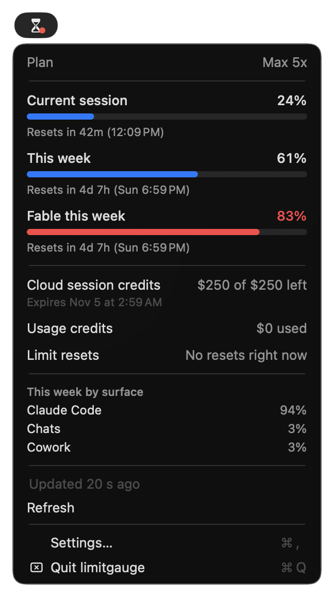
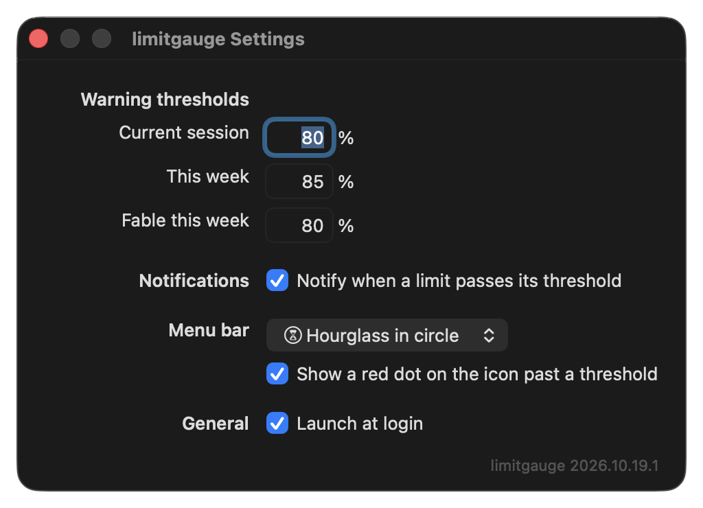
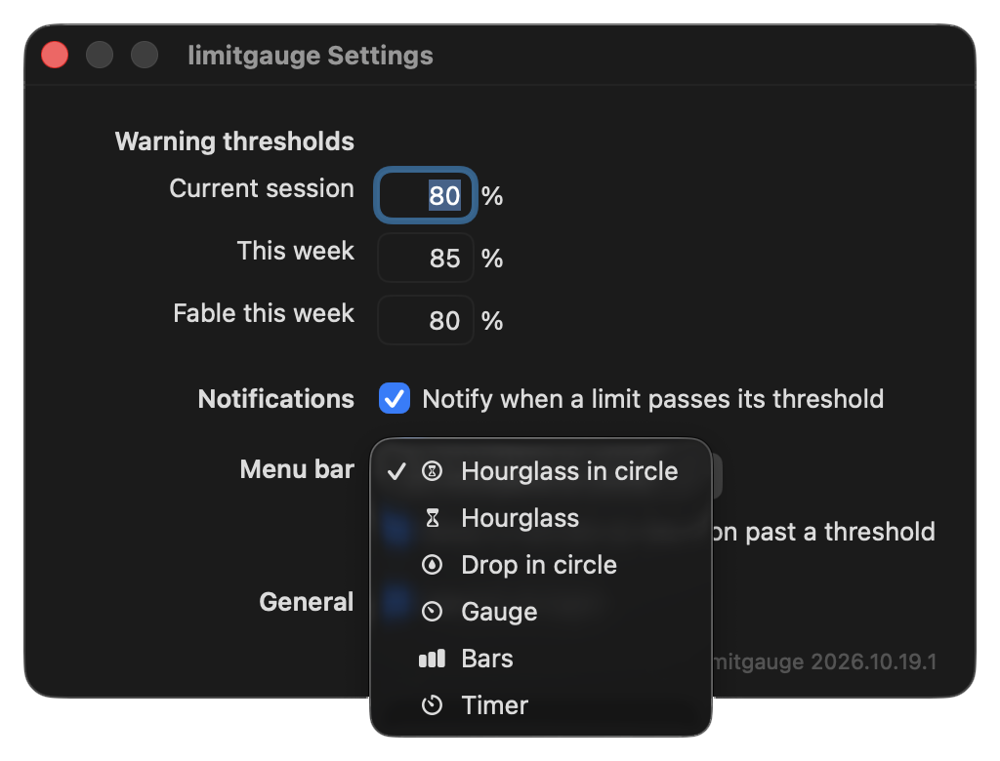

# limitgauge

	

limitgauge shows your Claude plan's usage limits in the macOS menu bar. Click the icon to see
the current session, this week, and the weekly model limit, each with its reset time. The menu
also shows your credits and how the week splits across Claude Code, chats, and Cowork. These
are the same numbers as the Usage page in claude.ai settings.

When a limit passes a threshold you set, limitgauge sends a notification and puts a red dot on
its icon. It reads the sign-in that Claude Code already keeps in your Keychain, so you have
nothing to configure and no token to paste.

limitgauge is unofficial and not affiliated with Anthropic.

## Why limitgauge

limitgauge never raises a Keychain dialog, never refreshes or rewrites Claude Code's sign-in,
and calls only two read-only endpoints on `api.anthropic.com`. In the background, it checks
hourly while your limits are far from their thresholds and every 10 minutes when one gets close.

## Requirements

- macOS 26 or later.
- Xcode 26, or its command line tools.
- Claude Code, signed in with your Claude subscription on this Mac.

## Install

limitgauge has no prebuilt download. Build it from source:

	git clone https://github.com/eladefrati/limitgauge.git
	cd limitgauge
	make install

`make install` builds the app, signs it, and copies it to `/Applications`. Open **limitgauge**
from Applications. It runs in the menu bar and has no Dock icon. On first launch, macOS asks
whether limitgauge can send notifications.

If your keychain has an Apple Development certificate, `make install` signs with the first
one it finds. To use a different one, run `make install SIGN_IDENTITY="<certificate name>"`.
Without a certificate, `make install` signs the build ad hoc, and macOS can reset the
notification permission and **Launch at login** each time you rebuild.

limitgauge raises no Keychain dialog. If macOS asks for access to the "Claude
Code-credentials" item, choose **Deny**. limitgauge doesn't need that access. The dialog means
something outside limitgauge changed, most likely how Claude Code stores the item
([ADR-0004](docs/adr/0004-read-credentials-through-security-cli.md)).

## Read your limits

- Click the icon. The menu shows your plan, each limit with its percent and reset time, your
  credits, and the week by surface.
- limitgauge fetches new numbers when you open the menu, if the last fetch is more than two
  minutes old. **Refresh** fetches at once.
- A red dot on the icon means a limit is past its warning threshold.
- While no five-hour window is open, **Current session** shows 0% and no reset time.

Between fetches, limitgauge checks in the background only to send warnings. The closer a limit
is to its threshold, the sooner the next check: every 60, 30, or 10 minutes. After a failed
fetch, the checks space out.
[ADR-0002](docs/adr/0002-fetch-on-open-and-headroom-polling.md) has the full rules.

## Set thresholds and the icon

	
	

Choose **Settings…** from the menu to set:

- a warning threshold for each limit, in percent,
- whether limitgauge sends notifications,
- the menu bar icon, from six styles, and whether it shows the red dot,
- whether limitgauge opens at login.

## Your token and the network

limitgauge reads Claude Code's OAuth access token with this command, the same one Claude Code
uses for the Keychain item:

	/usr/bin/security find-generic-password -s "Claude Code-credentials" -w

It sends the token only to `api.anthropic.com`, in the `Authorization` header of `GET`
requests to two endpoints:

| Endpoint | What limitgauge reads | How often |
|---|---|---|
| `/api/oauth/usage` | Your limits, credits, and the week by surface | On each fetch |
| `/api/oauth/profile` | Your plan name | At most once a day |

limitgauge makes no other network requests. It keeps the token in memory only and never writes
it to disk or to the log. It never refreshes the token or changes the Keychain item. When the
token expires, the menu tells you to run `claude` in a terminal, which signs you in again.

Neither endpoint is part of Anthropic's documented API. Anthropic can change or remove them
without notice. Depending on the change, limitgauge then shows an error instead of numbers, or
a row goes missing from the menu with no error. See
[ADR-0001](docs/adr/0001-usage-endpoint-with-claude-code-token.md).

## What limitgauge stores

In its preferences, under `io.github.eladefrati.limitgauge`, limitgauge keeps its settings, the
last usage numbers, your plan name, and a record of the warnings it sent. The profile response
also holds your account email. limitgauge keeps only the plan name from it. It doesn't cache
responses, so no response reaches disk.

limitgauge logs failures to the macOS unified log, never the token or a response body. To watch
the log, run `make log`.

## Uninstall

1. In **Settings…**, turn off **Launch at login**.
2. Quit limitgauge from its menu.
3. Delete `/Applications/limitgauge.app`.
4. To delete its stored settings and numbers too, run
   `defaults delete io.github.eladefrati.limitgauge`.

## Develop

`make test` runs the tests. `make run` builds the app, quits a running limitgauge, and opens the
new build from `build/limitgauge.app`.

Run limitgauge only from its app bundle. `swift run` and `.build/release/limitgauge` crash at
launch, because Notification Center needs the bundle's identifier.

The [proposal](docs/proposal.md) is the original design, kept as written. The
[ADRs](docs/adr/) record the decisions since, and
[changes since the proposal](docs/changes-since-proposal.md) lists where limitgauge differs
from the proposal.

## License

MIT. See [LICENSE](LICENSE).
